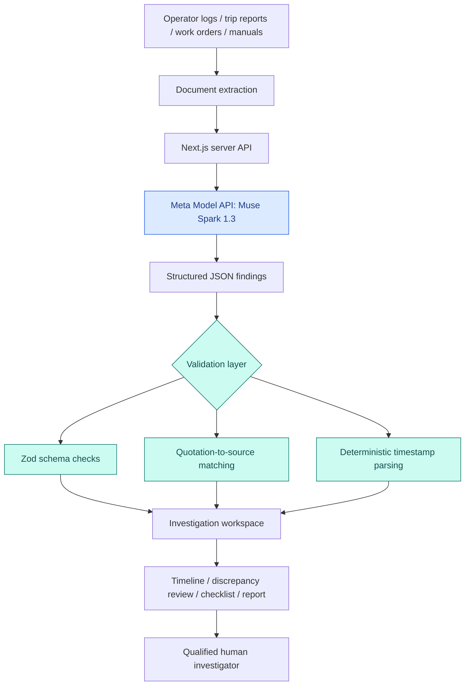

<div align="center">

# ⚡ PlantPulse

### When machines fail, the evidence shouldn't be harder to understand than the failure.

**An AI-powered incident investigation workspace for power-generation and industrial maintenance teams.**  
Turn scattered operational records into timelines, evidence-linked discrepancies, historical context, and human-reviewable next steps.

[](https://plant-pulse-sepia.vercel.app/)
[](https://github.com/MaskedMan-code/PlantPulse)


**Meta Global AI Developer Hackathon 2026** · Indie Developer Track · Push the Frontier

</div>

---

## The problem, in one minute

A power-plant trip rarely comes with one neat explanation. The evidence lives in different places: a shift operator's notes, a control-system trip report, a maintenance work order, an equipment manual, and perhaps an older incident that sounds similar.

One document might say the pump tripped at **03:02**. Another records **03:07**. An operator reports unusual noise; another report says no noise was observed. Which records agree? Which ones conflict? What information is missing?

**PlantPulse helps investigators ask better questions of their evidence.** It does not decide the cause of a failure or tell engineers how to operate equipment.

> **The principle:** AI can help connect records. Humans remain responsible for interpreting the evidence and making engineering decisions.

## What you can do

| Workspace | What it does |
| :-- | :-- |
| **📁 Documents** | Upload readable **PDF, TXT or Markdown** records; inspect extracted text and references. |
| **🕒 Timeline** | Reconstruct time-ordered events and separate observations with no reliable timestamp. |
| **⚠️ Contradictions** | Compare potentially conflicting statements side by side, alongside their source quotations. |
| **🔗 Similar Incidents** | Use a supplied historical record to find relevant similarities **and important differences**. |
| **☑️ Review Checklist** | Turn gaps into evidence requests; mark tasks complete, add comments, or reject suggestions. |
| **📝 Export Report** | Produce a readable draft investigation report and **Print / Save as PDF**. |

The workspace includes **Midnight Operations, Precision Light, and High Contrast** themes, plus responsive navigation and browser-session persistence.

## See it in action

**[Launch PlantPulse →](https://plant-pulse-sepia.vercel.app/)**

1. Select **Load Demo Incident** on the Overview screen.
2. Select **Analyze Incident with Meta AI**. This makes a real server-side model request; an available Meta API connection is required.
3. Explore **Timeline → Contradictions → Similar Incidents → Checklist**.
4. Open a cited quotation to inspect its original document, then visit **Export Report**.

### A small discrepancy with big investigative value

The bundled *fictional* boiler feedwater pump incident contains these two observations:

| Shift operator log | Equipment trip report |
| :-- | :-- |
| **03:02** — BFP-2A tripped; unit load reduced to 90 MW. | **03:07** — DCS recorded the BFP-2A trip time. |

**Five minutes apart.** PlantPulse surfaces the disagreement, shows the source passages, and recommends reconciling the records. It **does not assume which timestamp is correct**.

Other intentionally inconsistent observations concern pre-trip noise and whether standby pump BFP-2B was started manually or automatically. All locations, personnel, equipment records, and incidents in the bundled demonstration are fictional.

## How PlantPulse works



### The division of responsibility

**Meta Muse Spark 1.3** handles language-intensive work: interpreting separate records, extracting event descriptions, identifying potential conflicts, proposing questions, and comparing incident narratives.

**PlantPulse's own code** handles file validation, PDF text extraction, output-schema validation, quotation matching, deterministic timestamp parsing and ordering, the review interface, and report presentation.

This distinction matters: **a quotation found in a source is not proof that the AI interpreted it correctly.** The interface labels cited text as source-verified while keeping possible discrepancies subject to human review. Unsupported citations are filtered from the relevant result sections.

### Why Meta AI is central

PlantPulse integrates the **Meta Model API** through its server-side **Responses API**, using an OpenAI-compatible JavaScript SDK. The configured model is `muse-spark-1.3`. The application asks the model for structured incident findings instead of a free-form chatbot answer.

There are **no prerecorded model answers** in the app's analysis flow. The bundled sample documents are fictional, but analysis is requested from the live Meta API. If the API is unavailable, PlantPulse reports an error rather than silently substituting fabricated results.

## Technology choices

| Layer | Technology | Why it is here |
| :-- | :-- | :-- |
| User interface | **Next.js 15, React 19, TypeScript, Tailwind CSS** | A fast, responsive investigation workspace. |
| AI inference | **Meta Muse Spark 1.3, Meta Model API** | Cross-document interpretation and structured investigation findings. |
| API integration | **OpenAI-compatible JavaScript SDK** | Server-side connection to Meta's Responses API; this does **not** imply using OpenAI models. |
| PDF extraction | **unpdf** | Reads text from supported digital PDFs, with page text where available. |
| Validation | **Zod** | Rejects responses that do not match the expected shape. |
| Evidence checks | **Custom TypeScript utilities** | Matches quotations against provided source text and orders timestamps. |
| Local state | **Browser localStorage** | Persists demo documents, analysis results and checklist state in the browser. |
| Tests | **Vitest, TypeScript, ESLint** | Validates selected utilities, types, and code quality. |
| Hosting | **Vercel** | Runs the Next.js application and server-side API routes. |

## Run it locally

**Prerequisites:** Node.js and npm, plus a Meta Model API key with access to the configured model.

```bash
# Clone the repository
git clone https://github.com/MaskedMan-code/PlantPulse.git
cd PlantPulse

# Install dependencies
npm ci

# Configure server-side secrets
cp .env.example .env.local
```

Edit `.env.local`:

```dotenv
MODEL_API_KEY=your_meta_model_api_key
META_MODEL=muse-spark-1.3
```

Then start the app:

```bash
npm run dev
```

Open **http://localhost:3000**. Never commit `.env.local` or expose your API key in the browser.

### Verification commands

```bash
npm run typecheck
npm run lint
npm test
npm run build
```

**Latest reported local check (4 November 2026):** typecheck passed, lint passed, **12/12 unit tests passed**, and the Next.js production build succeeded. These tests cover file rules, date parsing, ordering, output schemas, quotation checks and selected Meta-integration safeguards. They are **not** a production reliability benchmark or a comprehensive live-model evaluation.

## API endpoints

| Endpoint | Role |
| :-- | :-- |
| `GET /api/health` | Basic application health check. |
| `GET /api/model-status` | Checks Meta API availability using a real model request. |
| `POST /api/extract` | Processes supported uploaded files and extracts readable text. |
| `POST /api/analyze` | Requests model analysis and validates the returned findings. |

## Safety is part of the design

PlantPulse is intentionally a **decision-support prototype**, not a plant-control system.

- **No autonomous control:** It cannot issue commands to equipment, a DCS, or a safety system.
- **No confirmed root-cause claims:** Findings distinguish observations, suspected contradictions, missing information and review tasks.
- **Evidence traceability:** Source quotations are checked against uploaded text; **the interpretation itself is not independently verified**.
- **Untrusted documents:** The model prompt treats uploaded records as untrusted data, not instructions to obey.
- **Human review:** Investigation questions and checklists remain advisory.

### Current limitations

- The included historical comparison library is a **single fictional incident**, not an industrial knowledge base.
- Scanned, image-only PDFs are not supported; the MVP does **not** include OCR.
- Uploaded text and investigation state are saved in browser localStorage. **Do not use this public demo for confidential plant records or personal information.**
- The prototype does not include user accounts, organisational permissions, audit logging, or robust per-user API rate limiting. A production deployment would require all of these, as well as formal security and domain validation.
- Matching a quotation to its source does not establish the accuracy of an AI-generated explanation or the true cause of an incident.

## Where this could go next

The MVP demonstrates a single end-to-end workflow. Meaningful next steps include controlled multi-user collaboration, proper document access permissions, stronger evidence-level evaluation, a larger verified historical incident library, and domain-expert validation with maintenance engineers.

The aim is not a more confident AI answer. It is **a better-informed, more auditable human investigation**.

---

<div align="center">

### Built for the Meta Global AI Developer Hackathon 2026

**Indie Developer Track · Push the Frontier**  
Built as a solo-developer prototype using Meta Muse Spark.

**[Try the live demo](https://plant-pulse-sepia.vercel.app/)** · **[Explore the code](https://github.com/MaskedMan-code/PlantPulse)**

*PlantPulse — continuous curiosity, grounded in evidence.*

</div>
